# Nashr: the product so far

These are screenshots of the working app, taken from the real software running with demo data (November 2026). Everything shown works end to end: bidding, the publisher's decision, payment held safely, creative, proof, release of the money, invoices and the admin tools.

The colours, fonts and logo are placeholders until your brand files arrive. Swapping them is a small change in one place.

## Sign in

Nashr is invite-only. Companies request access, and the Nashr team approves them.

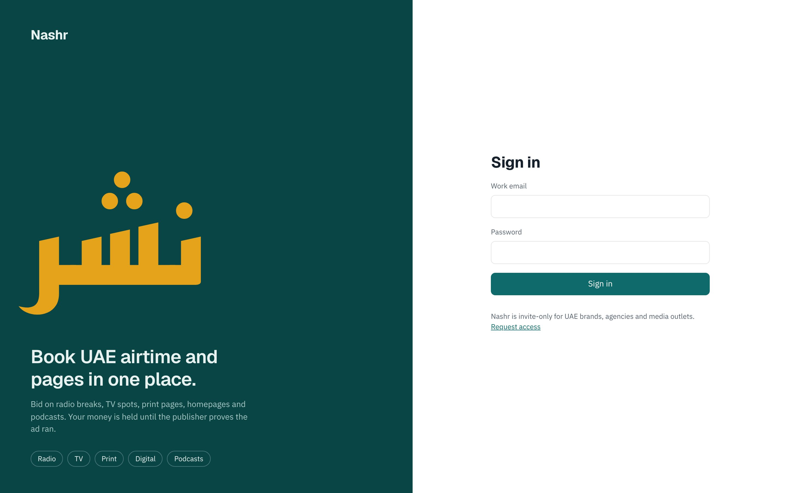

## For buyers (brands and agencies)

**The calendar.** Every bookable radio, TV, print, digital and podcast slot in the UAE, by day, week or month, in Dubai time.

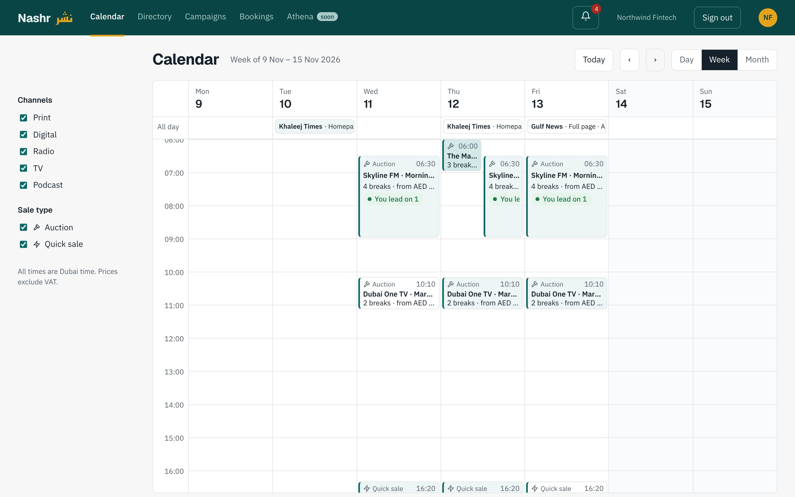

**One programme.** Each break can be bought on its own, as "any break", or as a package.

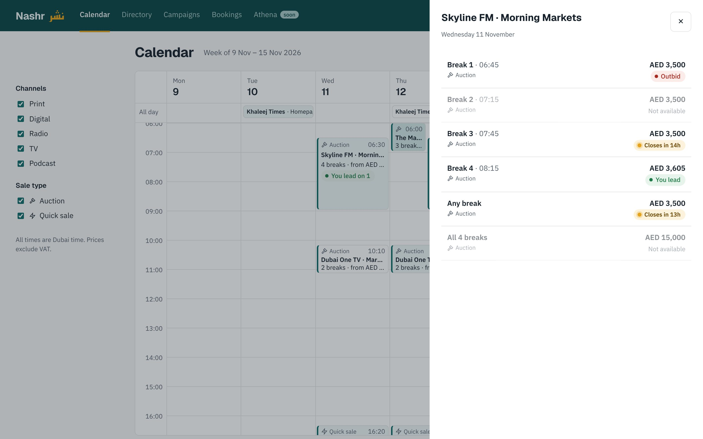

**Bidding.** The minimum next bid is worked out for you. You can set an auto-bid maximum, or request the buy-now price. The booking brief goes with your first bid, and nothing is charged until the publisher accepts.

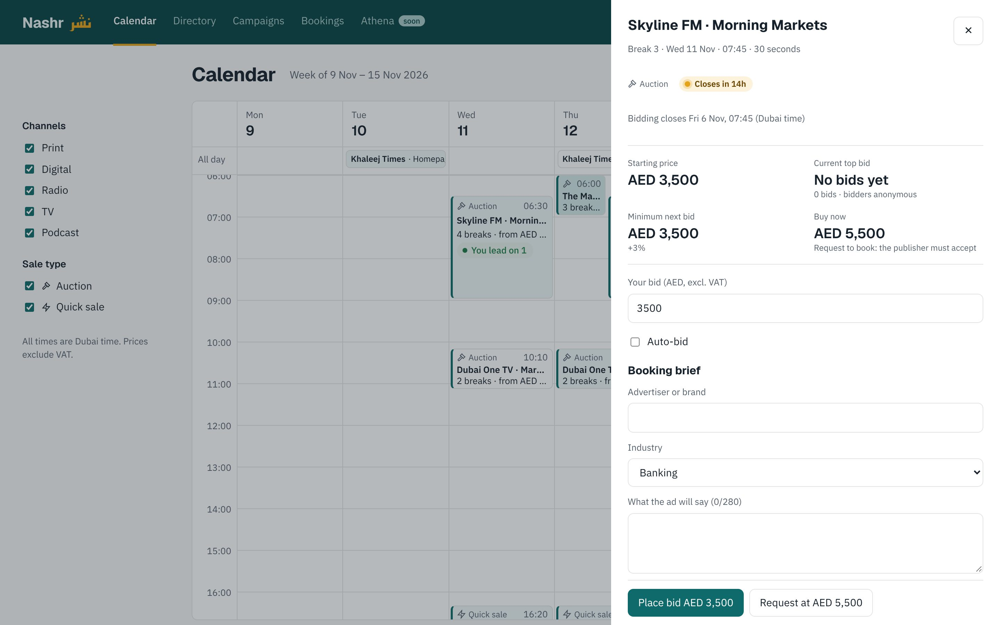

**Directory.** Every UAE outlet. Each price is labelled to say where it comes from: typical on Nashr, the publisher's own rate, or Nashr's estimate. Outlets not on Nashr yet take a quote request. Saudi outlets show as "coming soon".

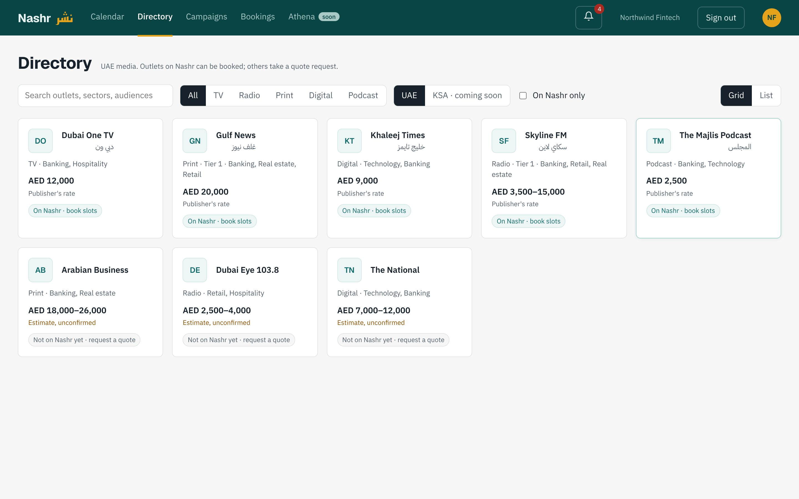

**Campaigns.** A budget and a plan per outlet, with what's committed, waiting and left.

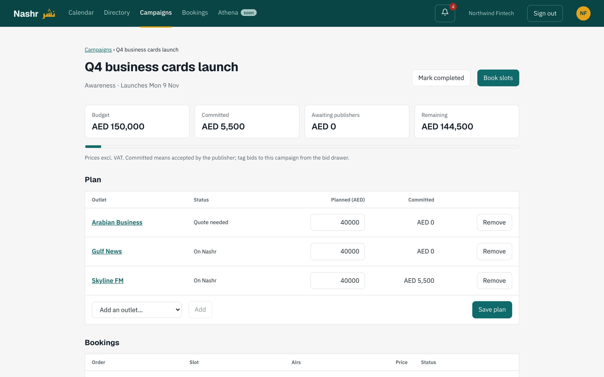

**A booking.** Pay once the publisher accepts. The money is held until you approve proof that the ad ran. Creative, proof, invoices and the full history are all on one page.

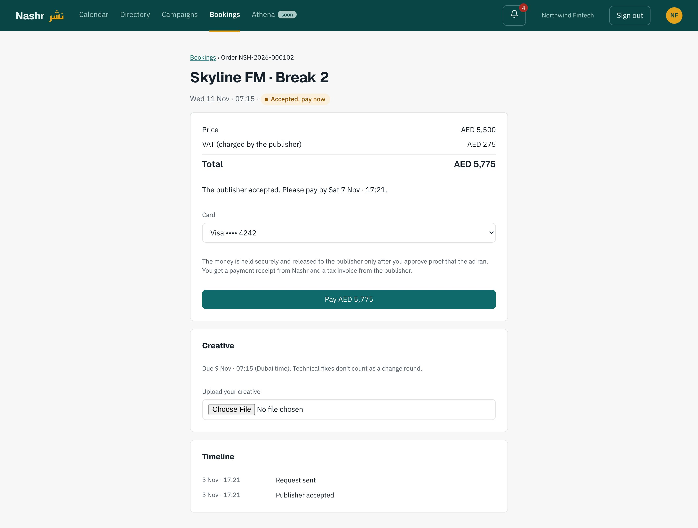

## For publishers

**Dashboard.** What needs you, money held and released, and what's coming up.

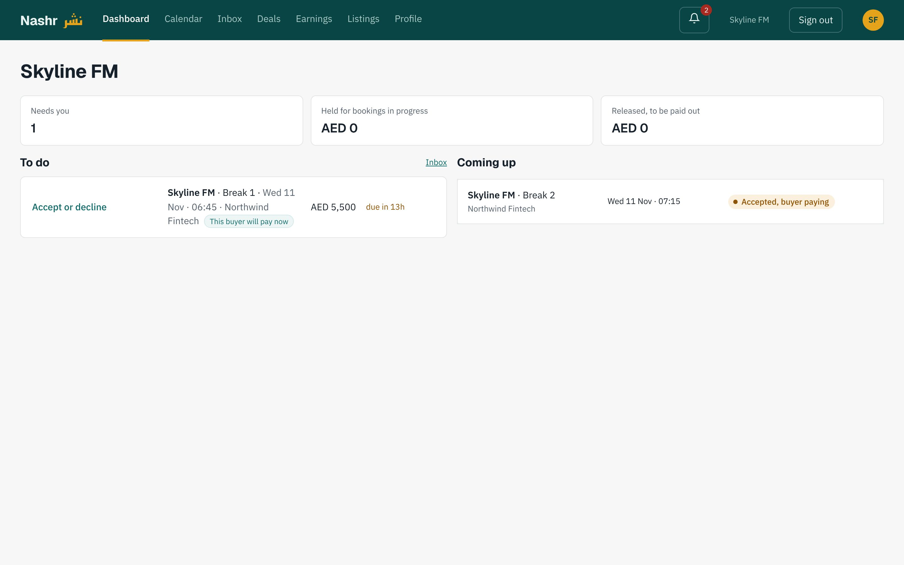

**A request to decide.** The publisher sees exactly what they receive after VAT and Nashr's commission, the brief, and automatic checks. Then they accept or decline.

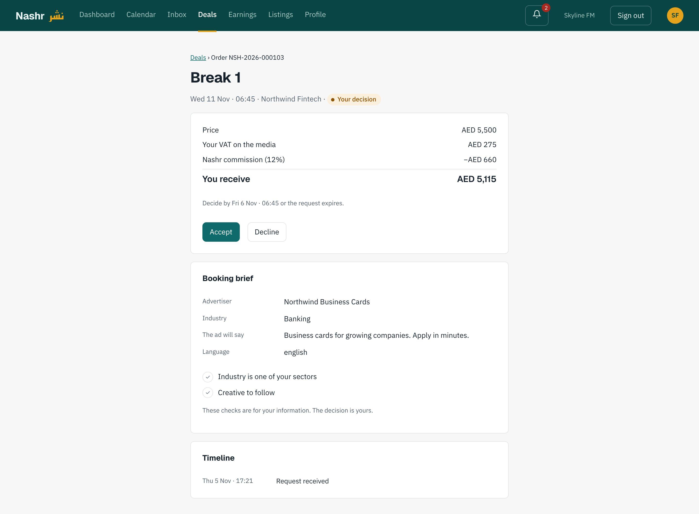

**Their calendar.** Every programme by day, with what's on sale, booked or waiting.

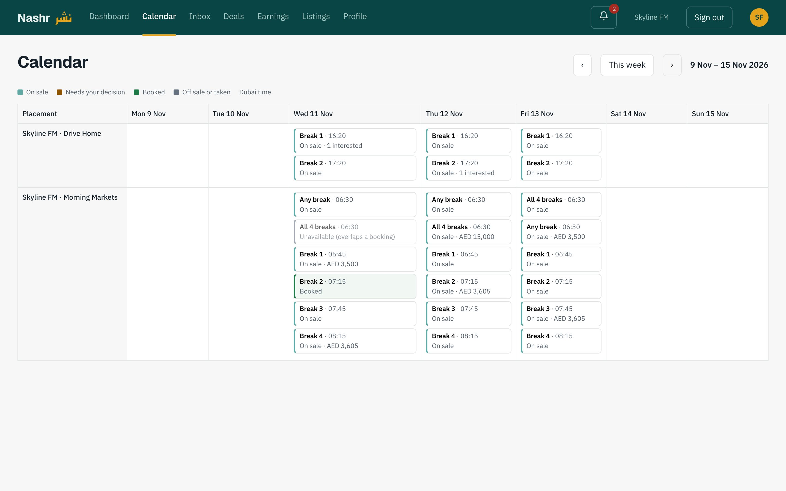

**Adding a placement.** Days, times (overnight works), breaks, prices for single breaks, any break and packages, buy-now, reserve, and deadlines that are checked automatically.

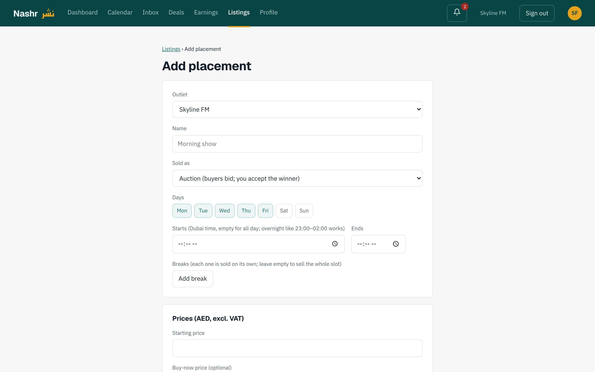

## For the Nashr team

**Overview.** This month's bookings, money held, commission earned, and anything that needs attention.

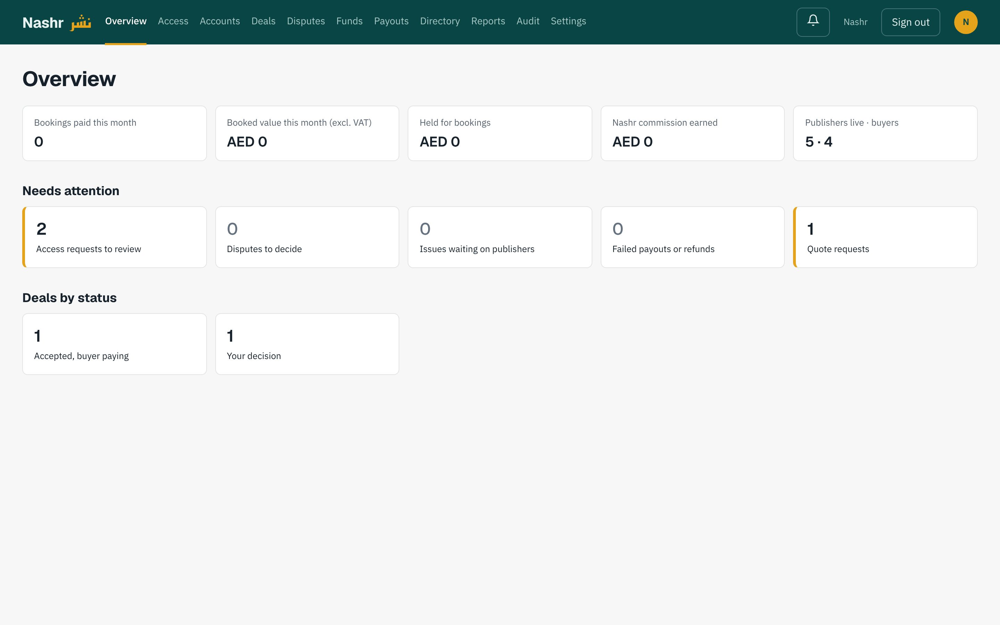

**Funds.** Every account in the ledger, checked against the payment provider every minute.

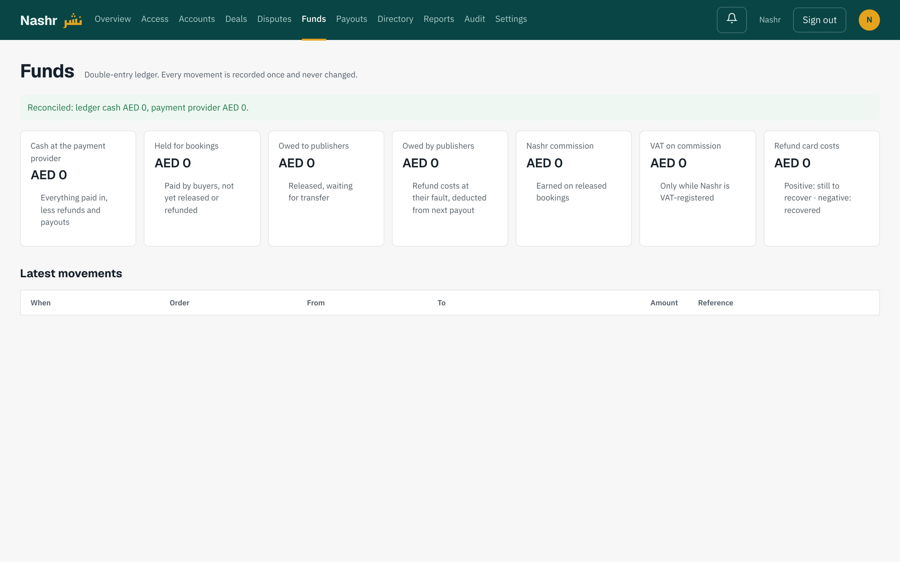

**Settings.** Every rule (windows, fees, VAT) is a setting with its full history. Financial settings can only be changed by the founder.

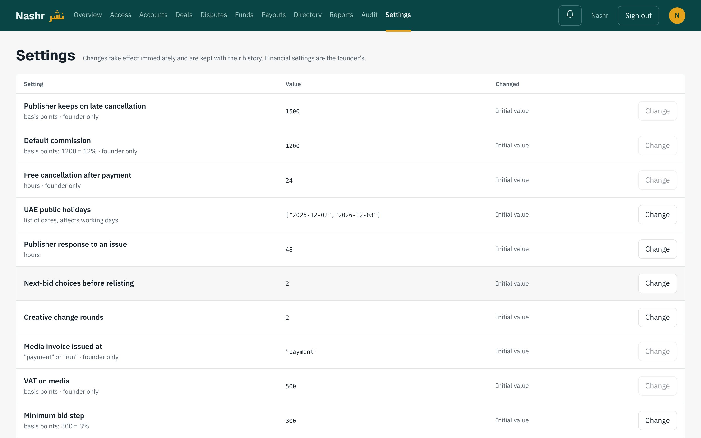

## On a phone

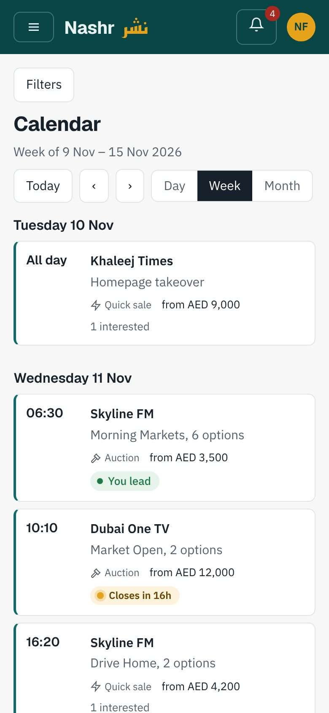 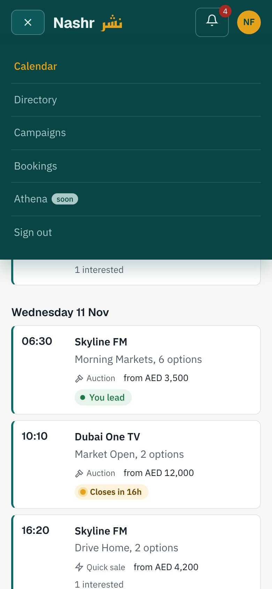

## What's next

- **Payments:** connect Stripe. This needs your Stripe test account, then the live one.
- **Hosting:** put Nashr online on AWS for a closed pilot with a few publishers and buyers. The plan is in [docs/pilot-plan.md](../pilot-plan.md).
- **Your input:** brand files, the email service, and accountant and legal sign-off.
